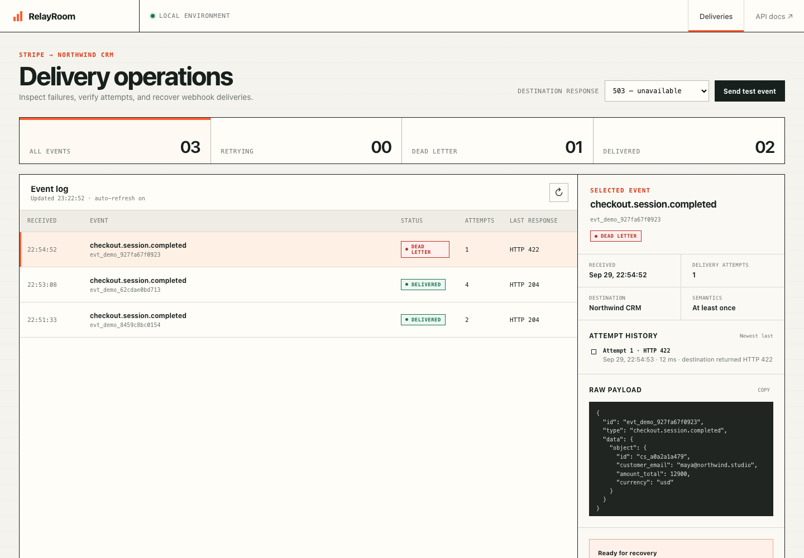

# RelayRoom — Webhook Operations Case Study

RelayRoom is a focused reference implementation of a reliable Stripe-to-CRM integration. It accepts signed events, persists them before processing, delivers them asynchronously, records each attempt, retries transient failures, and provides a safe recovery path.



This is deliberately not a generic Hookdeck or Svix clone. It demonstrates the engineering required when a client needs custom business logic and an owned recovery workflow around one integration.

## What the demo proves

The first vertical slice includes:

- Stripe-compatible raw-body HMAC verification with timestamp tolerance
- PostgreSQL event and attempt models
- Duplicate-safe ingestion using the provider event ID
- Immediate `202 Accepted` response and Redis job enqueue
- ARQ background delivery with bounded retries
- Delivered, retrying, and dead-letter states
- Safe error messages without leaking response bodies
- Manual replay limited to terminal failures, avoiding duplicate concurrent recovery jobs
- Idempotent CRM-side business handling even when the same event is delivered again
- Transient (`408`, `429`, `5xx`) versus permanent (`4xx`) failure classification
- Controllable CRM destination simulator with healthy, unavailable, rejected, and timeout modes
- Operations console with status filters, payload inspection, attempt history, and recovery action
- Alembic schema migrations
- JSON request logs and end-to-end request correlation IDs
- Health and dependency-readiness endpoints
- Webhook payload size limits
- Docker Compose for API, worker, PostgreSQL, and Redis
- Automated signature, validation, ingestion, failure-policy, and idempotency tests

The delivery model is intentionally **at least once with idempotent business handling**. RelayRoom does not claim exactly-once delivery across network boundaries.

## Run

```bash
cp .env.example .env
docker compose up --build
```

Open the operations console at `http://localhost:8020`. Swagger is available at `http://localhost:8020/docs`.

Create a sample event:

```bash
curl -X POST http://localhost:8020/api/v1/demo/events
```

The destination simulator starts in `failure` mode so retries are visible. You can change the mode directly in the console, send a test event, inspect its attempts, recover the destination, and replay an eligible dead-letter event.

The same recovery can be exercised through the API:

```bash
curl -X PUT http://localhost:8020/api/v1/demo/destination \
  -H 'Content-Type: application/json' \
  -d '{"mode":"success"}'
```

Then list events and replay an eligible event through the documented API.

## Architecture

```text
signed webhook ──► FastAPI ingress ──► PostgreSQL event log ──► Redis queue
                         │                                      │
                         └── immediate 202                       ▼
                                                           ARQ worker
                                                                │
                                              attempt log ◄──────┤
                                                                ▼
                                                     idempotent CRM action
```

The ingress verifies the signature against the unmodified request body and persists the event before enqueueing work. A unique provider event ID protects ingestion, while the simulated CRM has its own unique source-event key to protect the actual business side effect. This separation matters: queue deduplication alone cannot guarantee that a downstream action happens once.

## Failure policy

- Network errors, timeouts, `408`, `409`, `425`, `429`, and `5xx` responses are retryable.
- Other `4xx` responses are treated as permanent and move directly to dead letter.
- Retries are bounded and use increasing delays.
- Only dead-letter events can be manually replayed.
- Response bodies are not stored in errors, reducing accidental secret leakage.

## Quality checks

```bash
uv sync --all-extras
uv run ruff check .
uv run pytest -q
docker compose config --quiet
```

The current suite covers signature validation, timestamp tolerance, duplicate ingestion, payload limits, request IDs, dependency readiness, permanent/transient classification, UI serving, safe replay, and business-side idempotency.

## Deliberate limits

RelayRoom is a focused integration case study, not a hosted webhook platform. It does not include multi-tenancy, billing, arbitrary endpoint registration, a visual workflow builder, or claims of global high availability. Production deployment would add authentication/authorization for the console, encrypted secrets, provider-specific event schemas, metrics/alerts, and deployment-level backup and restore procedures.
